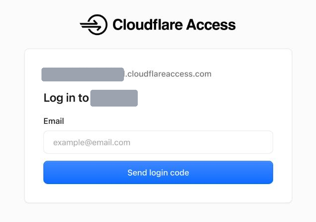

## はじめに

最近は Coding Agent のおかげで、ちょっとしたアプリなら週末にサクッと作れるようになりました。「こういうのがあったら便利だな」と思ったら、とりあえず作ってみる。個人開発のハードルは本当に下がったと感じます。

ただ、作ったアプリをどこで動かすかは、意外と悩みどころです。クラウドなどの費用をできるだけ抑えるためにサービスやアーキテクチャを選定することは、ときには楽しい作業ですが、本質ではありません。

そこで、安価なミニPCを購入して自宅にサーバーを置くことにしました。サーバーなら、非同期処理もバッチ処理もキューもDBも全部これだけで済みます。

ただし、自宅サーバーをインターネットに公開するのは、このご時世とても怖いです。自宅のローカルネットワークに侵入でもされたら、ひとたまりもありません。この記事では、**自宅サーバー + Cloudflare Tunnel + Cloudflare Access** という組み合わせで、自宅サーバーを安全に公開する方法をご紹介します。

## Ansible でサーバの構成管理をする

サーバーの構成管理には Ansible を使っています。作業用の Mac のローカルにあるコードをサーバーに rsync で同期し、サーバー上で `docker compose up --build` するだけのシンプルな仕組みです。

これだけで、手元のコードがそのまま自宅サーバーで動きます。push も CI も待たなくていいので、「ちょっと直して、スマホで確認して、また直す」のサイクルがとても速いです。

新しいアプリを追加するときも、`compose.yaml` を書いて、Ansible の設定に数行足すだけです。

## Cloudflare Tunnel でポートを開けずに公開する

自宅サーバーで動かしている `cloudflared` が、**内側から Cloudflare に向けて接続**します。外からの通信は、Cloudflare を経由してこの接続を通ってくるので、ルーターのポートは閉じたままで大丈夫です。

前提として、独自ドメインを1つ取得して、Cloudflare で DNS を管理しておく必要があります。Cloudflare Registrar で取得してもいいですし、ほかのレジストラで取得したドメインのネームサーバーを Cloudflare に向けても大丈夫です。

Tunnel では、このドメインのサブドメインとサーバー内のサービスを結びつけられます。たとえば `app1.example.com` はアプリ1、`app2.example.com` はアプリ2、というように、**アプリごとにサブドメインを割り当てられます**。DNS のレコードも自動で作ってくれるので、自分で設定する必要はありません。

今回の構成では、アプリごとの `compose.yaml` に、アプリ本体と `cloudflared` を一緒に入れています。全体像はこんな感じです。

```html-embed
<div class="d">
  <div class="row">
    <div class="col">
      <div class="node">📱 スマホ（本人）<small>メールでログイン</small></div>
      <div class="node ai">🤖 AI エージェント<small>サービストークン</small></div>
    </div>
    <div class="arrow"><span class="lbl">https</span><span class="h">→</span><span class="v">↓</span></div>
    <div class="box cf">
      <div class="title">Cloudflare</div>
      <div class="node">Access<small>本人のメール / 許可したトークンだけ通す</small></div>
      <div class="sub">app1.example.com<br>app2.example.com</div>
    </div>
    <div class="arrow"><span class="lbl">Tunnel</span><span class="h">→</span><span class="v">↓</span></div>
    <div class="box srv">
      <div class="title">自宅サーバー（Docker）<small>ポート開放なし</small></div>
      <div class="compose"><span class="cap">app1 の compose</span><span class="node sm">cloudflared</span><span class="mini">→</span><span class="node sm">app1:3000</span></div>
      <div class="compose"><span class="cap">app2 の compose</span><span class="node sm">cloudflared</span><span class="mini">→</span><span class="node sm">app2:3000</span></div>
    </div>
  </div>
  <div class="deploy">
    <div class="up"><span class="v2">↑</span><span class="lbl">SSH + rsync → docker compose up --build</span></div>
    <div class="macrow">
      <div class="note">$ ansible-playbook site.yml -K --tags deploy</div>
      <div class="box mac">
        <div class="title">Mac</div>
        <div class="pair"><span class="node sm">アプリのリポジトリ</span><span class="mini">→</span><span class="node sm">Ansible</span></div>
      </div>
    </div>
  </div>
</div>
<style>
  :root {
    --bg: #ffffff; --fg: #1f2937; --muted: #6b7280; --line: #d1d5db;
    --node: #f3f4f6; --cf: #fff4e6; --cf-line: #f6821f;
    --srv: #eef6ff; --srv-line: #3b82f6; --mac: #f0fdf4; --mac-line: #22c55e;
    --ai: #f5f3ff; --ai-line: #8b5cf6;
  }
  [data-theme="dark"] {
    --bg: #111827; --fg: #e5e7eb; --muted: #9ca3af; --line: #4b5563;
    --node: #1f2937; --cf: #2a1d0f; --cf-line: #f6821f;
    --srv: #0f1d33; --srv-line: #60a5fa; --mac: #0e2318; --mac-line: #4ade80;
    --ai: #1e1733; --ai-line: #a78bfa;
  }
  * { box-sizing: border-box; }
  body { margin: 0; background: var(--bg); }
  .d { font-family: system-ui, -apple-system, "Hiragino Sans", sans-serif; color: var(--fg); background: var(--bg); padding: 8px; font-size: 13px; line-height: 1.4; }
  .row { display: flex; align-items: center; gap: 4px; }
  .col { display: flex; flex-direction: column; gap: 8px; flex: 0 0 auto; }
  .node { background: var(--node); border: 1px solid var(--line); border-radius: 8px; padding: 6px 10px; text-align: center; }
  .node small, .title small { display: block; color: var(--muted); font-size: 11px; font-weight: normal; }
  .node.ai { background: var(--ai); border-color: var(--ai-line); }
  .node.sm { padding: 4px 8px; font-size: 12px; white-space: nowrap; }
  .box { border: 2px solid var(--line); border-radius: 10px; padding: 8px; display: flex; flex-direction: column; gap: 6px; }
  .title { font-weight: bold; text-align: center; }
  .cf { background: var(--cf); border-color: var(--cf-line); flex: 0 1 160px; min-width: 0; }
  .srv { background: var(--srv); border-color: var(--srv-line); flex: 1 1 0; min-width: 0; }
  .mac { background: var(--mac); border-color: var(--mac-line); flex: 0 0 auto; }
  .sub { color: var(--muted); font-size: 11px; text-align: center; font-family: ui-monospace, monospace; }
  .compose { flex-wrap: wrap; position: relative; border: 1px dashed var(--srv-line); border-radius: 8px; padding: 16px 8px 6px; display: flex; align-items: center; justify-content: center; gap: 4px; }
  .cap { position: absolute; top: 2px; left: 8px; font-size: 10px; color: var(--muted); }
  .pair { display: flex; align-items: center; gap: 4px; }
  .mini { color: var(--muted); }
  .arrow { display: flex; flex-direction: column; align-items: center; color: var(--muted); flex: 0 0 auto; padding: 0 2px; }
  .arrow .h { font-size: 22px; line-height: 1; }
  .arrow .v { display: none; font-size: 22px; line-height: 1; }
  .lbl { font-size: 11px; text-align: center; }
  .deploy { display: flex; flex-direction: column; align-items: flex-end; gap: 4px; margin-top: 4px; }
  .up { display: flex; align-items: center; gap: 6px; color: var(--muted); padding-right: 40px; }
  .v2 { font-size: 22px; line-height: 1; }
  .macrow { display: flex; align-items: center; gap: 8px; }
  .note { font-family: ui-monospace, monospace; font-size: 11px; color: var(--muted); background: var(--node); border-radius: 6px; padding: 4px 8px; }
  @media (max-width: 600px) {
    .row { flex-direction: column; align-items: stretch; }
    .col { flex-direction: row; justify-content: center; }
    .cf, .srv { flex: 0 0 auto; }
    .d { font-size: 12px; }
    .arrow .h { display: none; }
    .arrow .v { display: block; }
    .deploy { align-items: stretch; }
    .up { justify-content: center; padding-right: 0; }
    .macrow { flex-direction: column-reverse; align-items: stretch; }
    .note { text-align: center; }
  }
</style>
```

アプリのコンテナはホストにポートを公開していません。届くのは、同じ compose の中にいる `cloudflared` だけです。Tunnel をアプリごとに分けているので、アプリ同士も分離されていて、どれか1つに何かあっても他のアプリには影響しません。

## Cloudflare Access で認証する

Access は、Cloudflare の手前で認証をしてくれる仕組みです。サブドメインごとに「誰を通すか」のポリシーを決めておくと、それ以外のリクエストは **Cloudflare の時点で止められて、自宅サーバーまで届きません**。

ポリシーは「自分のメールアドレスだけを許可する」の1つだけです。ログイン画面でメールアドレスを入力すると、ワンタイムのコードが届き、それを入力すると通れます。自分以外のメールアドレスでは通れません。



アプリに脆弱性があったとしても、悪意のあるリクエストがアプリに届かなければ、悪用されることはありません。ログイン画面への総当たり攻撃も、ボットによる脆弱性スキャンも、Cloudflare が手前で弾いてくれます。

認証機能をアプリに作り込まなくていい、というのも地味に嬉しいポイントです。個人で使うアプリのために、ログイン画面やパスワードリセットを作るのは面倒ですよね。Access に任せてしまえば、アプリは「認証済みのリクエストしか来ない」前提で作れます。

とはいえ、Cloudflare の設定を間違えてしまうこともありえます。Access アプリケーションをうっかり消してしまったら、アプリがむき出しになってしまいます。

そこで、念のためアプリ側でも Access を通ってきたリクエストかどうかを確認しています。Access を通ったリクエストには、`Cf-Access-Jwt-Assertion` というヘッダーに署名付きの JWT が付いてくるので、これを検証するだけです。

```ts
const { payload } = await jwtVerify(token, jwks, {
  audience: aud, // Access アプリケーションごとの AUD タグ
  issuer,
  algorithms: ['RS256'],
});
```

JWT がなかったり、検証に失敗したりしたら、アプリは 401 を返します。

## AI エージェントにはサービストークンを渡す

最近は、アプリの操作をAI エージェントに任せたくなる場面が増えてきました。ただ、AI に自分と同じ権限を渡すのは避けたいところです。意図しない操作をされてしまうことは普通に起こりえます。

Access には **サービストークン** という仕組みがあります。Client ID と Client Secret のペアを発行して、それをリクエストのヘッダーに付けると、メールでのログインなしに Access を通れます。AI エージェントには、このサービストークンを渡しています。

```bash
curl -H "CF-Access-Client-Id: $CLIENT_ID" \
     -H "CF-Access-Client-Secret: $CLIENT_SECRET" \
     https://app1.example.com/api/guide
```

サービストークンで通ってきたリクエストは、JWT の中身で本人と見分けられます。そこでアプリ側では、**AI が使える API を許可リストで絞って**、それ以外は 403 を返すようにしています。データの登録はできるけれど、設定の変更はできない、といった具合です。

さらに、`/api/guide` で AI 向けの使い方ガイドを Markdown で返すようにしています。AI には「まず `/api/guide` を読んでね」と伝えるだけで、あとは勝手に API の使い方を理解して作業してくれます。

## おわりに

ここまで紹介した Cloudflare の機能は、個人で使う規模なら無料プランの範囲で使えます。以上、AI Coding 時代には自宅サーバーはいいぞ、というお話でした。
